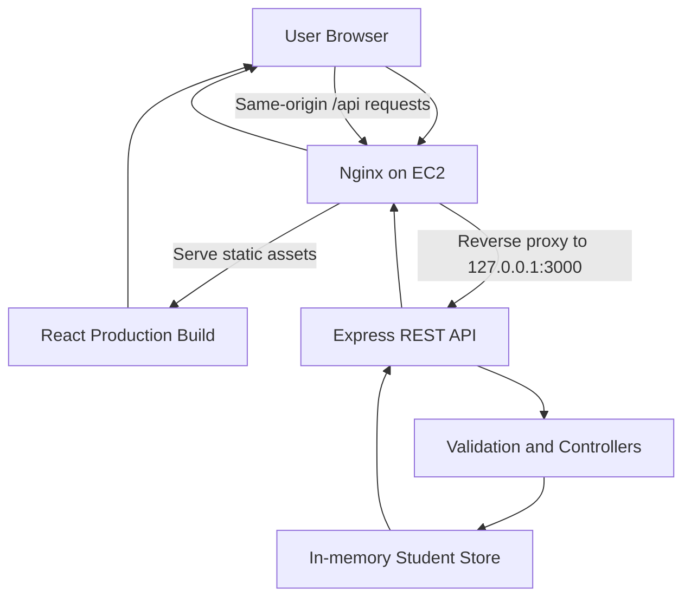
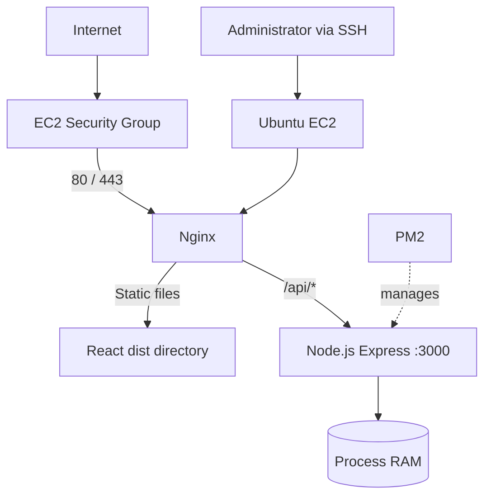

# Software Requirements Specification (SRS)

## Student Registration Application

**Document version:** 1.0  
**Status:** Baseline requirements  
**Architecture:** React frontend + Node.js/Express backend + REST API  
**Deployment target:** Existing AWS EC2 Ubuntu Linux instance  
**Database:** Not required  

------------------------------------------------------------------------

## Document Control

| Item | Description |
|---|---|
| Project | Student Registration Application |
| Document | Software Requirements Specification |
| Version | 1.0 |
| Frontend | React.js |
| Backend | Node.js with Express.js |
| Communication | REST API over HTTP/HTTPS using JSON |
| Runtime data | Backend in-memory storage |
| Hosting | AWS EC2 Ubuntu, Nginx, PM2 |

## 1. Introduction

### 1.1 Purpose

This document defines the functional and non-functional requirements,
architecture, API contract, integration approach, testing expectations,
and deployment requirements for a Student Registration Application.

The application will allow a user to enter student details through a
React web interface. The React frontend will send requests to a
Node.js/Express backend using REST APIs. The backend will validate and
temporarily store registrations in memory and return JSON responses.

This SRS is the baseline specification for design, implementation,
testing, and deployment. Development should be assessed against the
requirements and acceptance criteria in this document.

### 1.2 Scope

The first release will provide:

- A responsive student registration form.
- Capture of student name, email address, and phone number.
- Client-side and server-side validation.
- Submission of registration details to the backend.
- Display of success and validation/error messages.
- A list of registrations currently held in backend memory.
- Ability to view, update, and delete records held in memory.
- A health-check API.
- Deployment on an existing Ubuntu EC2 instance using Nginx and PM2.

**Important data limitation:** No database or persistent file storage is
included. Registration records exist only in the backend process's
memory. They are lost when the backend process restarts, the EC2
instance reboots, or the application is redeployed in a way that
restarts the process. The application must clearly communicate this
limitation to users and administrators. This release is suitable for
demonstration, testing, or temporary workflows, not permanent
student-record management.

### 1.3 Intended Audience

- Project owner and stakeholders.
- UI/UX designer.
- React frontend developer.
- Node.js backend developer.
- QA/test engineer.
- DevOps or EC2 administrator.
- Anyone reviewing or accepting the delivered application.

### 1.4 Definitions and Acronyms

| Term | Meaning |
|---|---|
| SRS | Software Requirements Specification |
| UI | User Interface |
| API | Application Programming Interface |
| REST | Representational State Transfer |
| JSON | JavaScript Object Notation |
| EC2 | Amazon Elastic Compute Cloud |
| Nginx | Web server and reverse proxy |
| PM2 | Node.js process manager |
| CRUD | Create, Read, Update, Delete |
| In-memory | Data held in the running process's RAM |

### 1.5 Assumptions and Constraints

- An Ubuntu EC2 instance already exists and the project owner can access it through SSH.
- The project owner can configure the EC2 security group and DNS, if a domain is used.
- The application will use a supported Node.js LTS release compatible with the selected dependencies.
- The initial release uses JavaScript rather than TypeScript.
- The frontend will be built with React and Vite.
- The backend will use Node.js and Express.
- No database, database driver, ORM, or persistent data store will be added.
- The backend will listen on port `3000` by default and bind to `127.0.0.1` where deployment permits.
- Nginx will serve the built React application and proxy `/api/` requests to the backend.
- Production frontend API requests will use the same origin, for example `/api`, rather than a hard-coded localhost address.
- The actual EC2 public IP address or domain name will be supplied during deployment; it is not assumed in this document.

## 2. Overall Description

### 2.1 Product Perspective

The application is a small full-stack web system consisting of two separately developed components:

1. **Frontend:** React single-page application (SPA) served as static production files by Nginx.
2. **Backend:** Express application running under PM2 and exposing JSON REST endpoints.

Nginx is the public entry point. It serves the React application and forwards API requests to the backend over the EC2 instance's loopback interface.

### 2.2 User Classes

| User class | Capabilities |
|---|---|
| Registration user | Enter and submit student details; view current in-memory registrations; edit or delete a record if those controls are enabled in the UI |
| Application operator | Deploy, start, stop, inspect logs, and restart the application on EC2 |

The initial release does not define user accounts, roles, authentication, or authorization. The registration list and mutation APIs must therefore not be treated as private or access-controlled student-record services. If public access to these operations is not appropriate, access restrictions must be added before production use.

### 2.3 Operating Environment

**Development environment**
- Windows, macOS, or Linux workstation.
- Node.js and npm.
- Git.
- Modern browser such as Chrome, Edge, Firefox, or Safari.

**Production environment**
- AWS EC2 instance running a supported Ubuntu LTS release.
- Nginx.
- Node.js LTS and npm.
- PM2.
- OpenSSH for administration.
- HTTP port 80 and, when TLS is configured, HTTPS port 443.

### 2.4 Design and Implementation Constraints

- Frontend and backend must remain separate deployable parts of one repository.
- Frontend/backend communication must use documented REST endpoints.
- API payloads and responses must be JSON.
- The application must not connect to a database.
- Runtime registration data must be held in memory only.
- No credentials, private keys, or production secrets may be committed to source control.
- Port 3000 must not be publicly exposed in the EC2 security group.
- The production frontend must not call `localhost` or `127.0.0.1` in the browser.

### 2.5 Dependencies

- React, Vite, and their supported dependencies.
- Node.js and Express.
- A validation library may be used, or equivalent explicit validation may be implemented.
- Axios or the browser Fetch API for HTTP requests.
- Nginx and PM2 on EC2.
- Git repository access for deployment.

Dependency versions must be pinned through the package lock files and installed with `npm ci` in repeatable build/deployment workflows.

## 3. Functional Requirements

### 3.1 Student Registration Form

| ID | Requirement | Priority |
|---|---|---|
| FR-001 | The system shall display a student registration form. | Must |
| FR-002 | The form shall capture the student's full name. | Must |
| FR-003 | The form shall capture the student's email address. | Must |
| FR-004 | The form shall capture the student's phone number. | Must |
| FR-005 | The form shall provide a clear submit action. | Must |
| FR-006 | The form shall indicate required fields. | Must |
| FR-007 | The form shall show field-level validation messages. | Must |
| FR-008 | The form shall prevent duplicate submissions while a request is in progress. | Must |

### 3.2 Registration Processing

| ID | Requirement | Priority |
|---|---|---|
| FR-009 | The frontend shall send valid form data to the backend using `POST /api/students`. | Must |
| FR-010 | The backend shall validate all submitted fields independently of frontend validation. | Must |
| FR-011 | The backend shall create a unique identifier for each accepted registration. | Must |
| FR-012 | The backend shall store accepted registrations in an in-memory collection. | Must |
| FR-013 | The backend shall return the created record and a success response. | Must |
| FR-014 | The frontend shall show a success message after a successful response. | Must |
| FR-015 | The frontend shall preserve entered values and show a useful message if submission fails. | Should |

### 3.3 Registration Listing

| ID | Requirement | Priority |
|---|---|---|
| FR-016 | The frontend shall provide a view of registrations currently held by the backend. | Must |
| FR-017 | The frontend shall request the list using `GET /api/students`. | Must |
| FR-018 | The backend shall return the current in-memory collection. | Must |
| FR-019 | The frontend shall show a loading state while retrieving registrations. | Must |
| FR-020 | The frontend shall show an empty state when no registrations exist. | Must |
| FR-021 | The frontend shall show a recoverable error message if the list cannot be loaded. | Must |

### 3.4 Update and Delete

| ID | Requirement | Priority |
|---|---|---|
| FR-022 | The backend shall support updating an existing in-memory record using `PUT /api/students/:id`. | Should |
| FR-023 | The backend shall support deleting an existing in-memory record using `DELETE /api/students/:id`. | Should |
| FR-024 | The backend shall return `404 Not Found` when the requested identifier does not exist. | Must |
| FR-025 | The frontend shall refresh or update the displayed list after a successful update or delete. | Should |
| FR-026 | The frontend shall ask for confirmation before deleting a record. | Should |

### 3.5 System Health

| ID | Requirement | Priority |
|---|---|---|
| FR-027 | The backend shall expose `GET /api/health`. | Must |
| FR-028 | The health endpoint shall return HTTP 200 when the API process is healthy. | Must |
| FR-029 | The health endpoint shall not expose secrets, environment variables, or internal stack traces. | Must |

## 4. Data Requirements (No Database)

### 4.1 Student Data Model

A student record shall use the following logical shape:

```json
{
  "id": "generated-unique-id",
  "fullName": "Anita Kumar",
  "email": "anita@example.com",
  "phone": "+919876543210",
  "createdAt": "2026-11-09T10:00:00.000Z",
  "updatedAt": "2026-11-09T10:00:00.000Z"
}
```

The example is illustrative. The backend shall generate `id`, `createdAt`, and `updatedAt`; clients shall not be trusted to set these system-managed fields.

### 4.2 Validation Rules

| Field | Rule |
|---|---|
| `fullName` | Required string; trim leading/trailing whitespace; 2–100 characters; reject blank values |
| `email` | Required string; trim whitespace; validate a reasonable email format; maximum 254 characters |
| `phone` | Required string; trim whitespace; allow a leading `+` and common phone-number separators; require 7–20 digits after removing separators |
| `id` | Generated by backend; immutable |
| `createdAt` | Generated by backend; immutable |
| `updatedAt` | Generated by backend; updated by backend on modification |

The application shall not assume a single country's phone-number format. Phone numbers shall be stored as strings to preserve leading zeroes and international prefixes.

### 4.3 In-Memory Storage Behavior

- The backend shall maintain a process-local array or Map of student records.
- The backend shall initialize the collection as empty when the process starts.
- Successful create, update, and delete requests shall modify that collection.
- A backend restart shall clear all records.
- Multiple backend instances shall not share their in-memory records.
- The application shall not imply that a successful registration has been permanently saved.
- The UI shall display a clear notice such as: **"Demo mode: registrations are temporary and will be cleared when the server restarts."**
- No file-based persistence, browser local storage as a substitute for server storage, database, or external storage service shall be introduced in this release.

## 5. Non-Functional Requirements

### 5.1 Performance

- The frontend should render the initial application shell promptly on a typical broadband connection.
- API requests should normally complete within 2 seconds under light demonstration load, excluding network or EC2 resource constraints.
- The application shall show progress feedback for requests that take noticeable time.
- The initial implementation is intended for low-volume demonstration use, not high-volume production workloads.
- No performance or availability SLA is implied by this SRS.

### 5.2 Usability and Accessibility

- The UI shall be responsive on common mobile, tablet, and desktop screen sizes.
- Form fields shall have visible labels.
- Validation messages shall be associated with their relevant fields.
- Keyboard navigation shall be supported for form controls and actions.
- Text and controls shall have sufficient visual contrast.
- Success and error feedback shall be understandable and not rely on color alone.

### 5.3 Reliability

- PM2 shall restart the backend process if it exits unexpectedly.
- Nginx and the backend shall be configured to start automatically after an EC2 reboot.
- A process restart does not preserve in-memory registrations.
- The health endpoint shall provide a basic check of backend process availability.

### 5.4 Maintainability

- Frontend code shall use reusable React components.
- Backend code shall separate routes, controllers, middleware, and application startup.
- Configuration shall be environment-driven.
- API behavior shall be documented.
- Dependencies shall be managed through package manifests and lock files.
- Application logs shall be available through PM2.

### 5.5 Compatibility

- The UI shall support current stable versions of major browsers.
- The production application shall be served over HTTP initially and be compatible with HTTPS once TLS is configured.
- The backend shall run on the selected supported Node.js LTS release.

## 6. Frontend Requirements

### 6.1 Technology

- React.js.
- Vite build tooling.
- JavaScript (ES modules).
- HTML5 and CSS3.
- Axios or Fetch API.
- Responsive CSS, with a lightweight component or styling approach.

### 6.2 Screens

**Screen 1: Student Registration**
- Application title and brief instructions.
- Temporary-data notice.
- Full Name input.
- Email input.
- Phone Number input.
- Submit button.
- Field validation and request status messages.

**Screen 2: Registered Students**
- List or table of current in-memory registrations.
- Loading indicator.
- Empty-state message.
- Refresh action.
- Edit and delete actions if implemented.
- Temporary-data notice.

These may be implemented as two routes or as sections within one page. The final navigation choice may be made during UI design without changing the API contract.

### 6.3 Suggested Frontend Structure

```text
frontend/
├── public/
├── src/
│   ├── components/
│   │   ├── Header.jsx
│   │   ├── StudentForm.jsx
│   │   ├── StudentList.jsx
│   │   ├── StudentRow.jsx
│   │   ├── LoadingState.jsx
│   │   └── Message.jsx
│   ├── pages/
│   │   └── StudentsPage.jsx
│   ├── services/
│   │   └── studentApi.js
│   ├── styles/
│   │   └── app.css
│   ├── App.jsx
│   └── main.jsx
├── .env.example
├── package.json
└── package-lock.json
```

### 6.4 Frontend API Configuration

The frontend shall use a configurable API base URL.

Example `.env.example`:

```dotenv
VITE_API_BASE_URL=/api
```

The frontend API service shall build requests from this configuration. In production, `/api` is a same-origin path routed by Nginx. The production browser bundle shall not contain `http://localhost:3000` or `http://127.0.0.1:3000`.

### 6.5 Frontend Error States

The frontend shall handle:
- Backend unavailable or network failure.
- Invalid input (`400`).
- Record not found (`404`).
- Rate limiting (`429`), if configured.
- Unexpected server error (`500`).
- Unexpected or malformed response.

The UI shall show a concise user-facing message. It shall not display raw stack traces or sensitive server details.

## 7. Backend Requirements

### 7.1 Technology

- Node.js LTS.
- Express.js.
- JSON request and response handling.
- Environment variables for runtime configuration.
- PM2 for production process management.

### 7.2 Suggested Backend Structure

```text
backend/
├── src/
│   ├── config/
│   │   └── environment.js
│   ├── controllers/
│   │   └── studentController.js
│   ├── middleware/
│   │   ├── errorHandler.js
│   │   └── notFound.js
│   ├── routes/
│   │   ├── healthRoutes.js
│   │   └── studentRoutes.js
│   ├── services/
│   │   └── studentStore.js
│   ├── validators/
│   │   └── studentValidator.js
│   ├── app.js
│   └── server.js
├── .env.example
├── package.json
└── package-lock.json
```

### 7.3 Backend Configuration

Example `.env.example`:

```dotenv
NODE_ENV=production
PORT=3000
HOST=127.0.0.1
```

The actual `.env` file shall not be committed to Git. The backend shall validate required configuration at startup and fail with a clear operational error if invalid configuration is supplied.

### 7.4 Middleware

The backend shall configure:
- `express.json()` with a reasonable request-body size limit.
- Request validation.
- A not-found handler.
- Centralized error handling.
- CORS only if cross-origin access is genuinely required.

When the React application and API are served from the same origin through Nginx, broad CORS access is unnecessary. If development uses separate frontend and backend origins, configure CORS to allow only the known development origin(s), rather than `*` by default.

### 7.5 Backend Logging

- Log startup and shutdown events.
- Log unexpected errors and relevant request metadata.
- Do not log full student records, credentials, tokens, or other unnecessary personal data.
- PM2 logs shall be used for operational diagnosis.
- Logs shall not be presented as a permanent student-record store.

## 8. REST API Specification

All API endpoints shall use the `/api` prefix and JSON payloads unless otherwise stated.

### 8.1 Common Response Format

Success:

```json
{
  "success": true,
  "message": "Operation completed successfully",
  "data": {}
}
```

Error:

```json
{
  "success": false,
  "message": "Request validation failed",
  "errors": [
    {
      "field": "email",
      "message": "Enter a valid email address"
    }
  ]
}
```

The exact `data` value depends on the endpoint. Error responses shall not contain stack traces in production.

### 8.2 Endpoint Summary

| Method | Endpoint | Description | Expected status |
|---|---|---|---|
| GET | `/api/health` | Check backend health | 200 |
| GET | `/api/students` | List current registrations | 200 |
| GET | `/api/students/:id` | Retrieve one registration | 200, 404 |
| POST | `/api/students` | Create registration | 201, 400 |
| PUT | `/api/students/:id` | Update registration | 200, 400, 404 |
| DELETE | `/api/students/:id` | Delete registration | 200, 404 |

### 8.3 Health Check

**Request**
```http
GET /api/health
```

**Response — HTTP 200**
```json
{
  "success": true,
  "message": "Node.js backend is running"
}
```

### 8.4 Create Student

**Request**
```http
POST /api/students
Content-Type: application/json
```

```json
{
  "fullName": "Anita Kumar",
  "email": "anita@example.com",
  "phone": "+919876543210"
}
```

**Response — HTTP 201**
```json
{
  "success": true,
  "message": "Student registered successfully. This record is temporary.",
  "data": {
    "id": "generated-unique-id",
    "fullName": "Anita Kumar",
    "email": "anita@example.com",
    "phone": "+919876543210",
    "createdAt": "2026-11-09T10:00:00.000Z",
    "updatedAt": "2026-11-09T10:00:00.000Z"
  }
}
```

### 8.5 List Students

**Request**
```http
GET /api/students
```

**Response — HTTP 200**
```json
{
  "success": true,
  "message": "Students retrieved successfully",
  "data": [],
  "count": 0,
  "storage": "memory-only"
}
```

The `data` array shall contain only registrations currently held by the running backend process.

### 8.6 Get One Student

**Request**
```http
GET /api/students/{id}
```

- Return HTTP 200 and the record if it exists.
- Return HTTP 404 with the standard error format if it does not exist.

### 8.7 Update Student

**Request**
```http
PUT /api/students/{id}
Content-Type: application/json
```

```json
{
  "fullName": "Anita K",
  "email": "anita.k@example.com",
  "phone": "+919876543210"
}
```

- Validate the submitted fields.
- Update only the permitted student fields.
- Preserve `id` and `createdAt`.
- Set `updatedAt` on the server.
- Return HTTP 404 if the ID does not exist.

### 8.8 Delete Student

**Request**
```http
DELETE /api/students/{id}
```

- Delete the matching in-memory record.
- Return HTTP 200 with a confirmation message.
- Return HTTP 404 if the ID does not exist.

### 8.9 HTTP Status Codes

| Status | Meaning |
|---|---|
| 200 | Request completed |
| 201 | Resource created |
| 400 | Invalid request or validation failure |
| 404 | Endpoint or student record not found |
| 413 | Request body too large, if body limit is exceeded |
| 429 | Too many requests, if rate limiting is configured |
| 500 | Unexpected server error |

## 9. Frontend–Backend Integration

### 9.1 Integration Flow

1. User opens the EC2-hosted application in a browser.
2. Nginx returns the React production files.
3. User enters student details and submits the form.
4. React validates the fields.
5. React sends a JSON `POST /api/students` request.
6. Nginx proxies `/api/` to `http://127.0.0.1:3000`.
7. Express validates the request again.
8. The backend creates an ID and stores the record in memory.
9. Express returns a JSON response.
10. React displays the result and refreshes the current registration list.

### 9.2 Integration Rules

- All API calls shall be made through a shared frontend service module.
- The API base URL shall come from environment configuration.
- Production shall use same-origin `/api` requests.
- The frontend shall not access the backend's in-memory collection directly.
- The frontend shall not assume a request succeeded until it receives and validates a successful API response.
- Request timeouts and network errors shall be handled.
- The API response structure shall follow the contract in Section 8.

### 9.3 Development Environment

During local development, Vite may proxy `/api` to the local Express server. This avoids scattering backend URLs throughout the UI. The production build shall use Nginx as the proxy instead.

## 10. System Architecture

### 10.1 Logical Architecture



### 10.2 Deployment Architecture



### 10.3 Network Rules

| Port | Source | Purpose |
|---|---|---|
| 22 | Administrator's trusted IP range | SSH administration |
| 80 | Internet, if public HTTP access is required | Nginx HTTP |
| 443 | Internet, if HTTPS is configured | Nginx HTTPS |
| 3000 | Localhost only | Express backend |

Port 3000 shall not be opened to the public internet. SSH should be restricted to the administrator's trusted IP address rather than `0.0.0.0/0`.

## 11. Security Requirements

- Validate and normalize all user-supplied fields on the server.
- Never trust frontend validation as the only validation layer.
- Use HTTPS in production when a domain and TLS certificate are available.
- Do not expose port 3000 publicly.
- Restrict SSH access to trusted administrator IPs.
- Do not commit `.env`, private keys, or credentials.
- Configure Nginx and Express to avoid exposing stack traces or internal configuration.
- Set reasonable JSON body-size limits.
- Consider rate limiting on public write endpoints before exposing the application to untrusted users.
- Do not add permissive CORS rules without a defined need.
- Avoid logging unnecessary personal information.
- Keep Node.js and system packages updated.
- The first release has no authentication or authorization. It must not be represented as a secure, private student information system. Add authentication, authorization, audit controls, and an appropriate persistent data design before using it for real institutional records.

## 12. Error Handling

### 12.1 Frontend

The UI shall:
- Show field-specific validation messages.
- Show a general message when the server is unavailable.
- Keep the user informed while requests are pending.
- Prevent repeated form submissions while a request is pending.
- Avoid exposing internal technical errors.

### 12.2 Backend

The API shall:
- Return consistent JSON error objects.
- Use appropriate HTTP status codes.
- Handle malformed JSON.
- Handle unknown routes.
- Handle unexpected exceptions through centralized middleware.
- Avoid returning stack traces in production.

### 12.3 Operational Failures

If Nginx cannot reach the backend, the API request may return a gateway error. The operator shall check Nginx status, PM2 process status, and backend logs.

## 13. AWS EC2 Deployment Requirements

### 13.1 Target Layout

The following paths are examples and may be changed to match the existing EC2 environment:

```text
/var/www/student-registration/
├── frontend/
│   └── dist/
├── backend/
│   ├── src/
│   ├── package.json
│   ├── package-lock.json
│   └── .env
└── deployment/
    ├── nginx.conf
    └── ecosystem.config.js
```

The `.env` file shall be readable only by the deployment user and authorized service account(s), and shall not be part of the public web root.

### 13.2 Prerequisites

- Existing Ubuntu EC2 instance.
- SSH access and sudo privileges.
- Git repository containing the application.
- EC2 security group access for required public ports.
- A domain name if HTTPS is to be configured using a publicly trusted certificate.

### 13.3 Install System Packages

Update the operating system and install Nginx and Git:

```bash
sudo apt update
sudo apt upgrade -y
sudo apt install -y nginx git curl
```

Install a currently supported Node.js LTS release using an approved installation method. Confirm the versions:

```bash
node --version
npm --version
```

Install PM2:

```bash
sudo npm install --global pm2
pm2 --version
```

### 13.4 Obtain the Source Code

```bash
sudo mkdir -p /var/www/student-registration
sudo chown -R "$USER":"$USER" /var/www/student-registration
cd /var/www/student-registration

git clone YOUR_GITHUB_REPOSITORY .
```

### 13.5 Configure and Start Backend

```bash
cd /var/www/student-registration/backend
npm ci
cp .env.example .env
```

Review `.env` and set the production values. Ensure the backend binds to `127.0.0.1` and port `3000`.

Start backend with PM2:

```bash
cd /var/www/student-registration
pm2 start deployment/ecosystem.config.js
pm2 status
pm2 logs student-registration-api
pm2 save
pm2 startup
```

### 13.6 Build Frontend

```bash
cd /var/www/student-registration/frontend
npm ci
cp .env.example .env
npm run build
```

Confirm build output exists in `frontend/dist`.

### 13.7 Nginx Configuration

Copy configuration:

```bash
sudo cp deployment/nginx.conf /etc/nginx/sites-available/student-registration
sudo ln -s /etc/nginx/sites-available/student-registration /etc/nginx/sites-enabled/student-registration
sudo rm -f /etc/nginx/sites-enabled/default
sudo nginx -t
sudo systemctl enable nginx
sudo systemctl reload nginx
sudo systemctl status nginx
```

### 13.8 EC2 Security Group

Configure inbound rules:
- TCP 22 from the administrator's trusted public IP range.
- TCP 80 from the intended application audience.
- TCP 443 from the intended application audience when HTTPS is enabled.
- Do not add a public inbound rule for TCP 3000.

### 13.9 HTTPS

For a production domain:
- Point DNS record to EC2 public IP.
- Configure TLS certificate using Let's Encrypt / Certbot:
  ```bash
  sudo apt install -y certbot python3-certbot-nginx
  sudo certbot --nginx -d YOUR_DOMAIN
  ```
- Automate certificate renewal.

### 13.10 Deployment Verification

Run on EC2:

```bash
# Backend direct health check
curl -i http://127.0.0.1:3000/api/health

# Health check through Nginx
curl -i http://127.0.0.1/api/health

# Check services
sudo systemctl status nginx
pm2 status

# Validate Nginx
sudo nginx -t
```

From a browser, open:
`http://YOUR_EC2_PUBLIC_IP/`

### 13.11 Reboot Verification

```bash
sudo reboot
```

After instance boots:
```bash
sudo systemctl status nginx
pm2 status
curl -i http://127.0.0.1/api/health
```

## 14. Testing Requirements

### 14.1 Test Strategy

Testing shall include frontend component and form tests, backend API tests, integration tests through Nginx, and deployment smoke tests on EC2.

### 14.2 Test Cases

| Test ID | Test scenario | Expected result |
|---|---|---|
| TC-001 | Open application root URL | React application loads |
| TC-002 | Open on mobile viewport | Layout remains usable |
| TC-003 | Submit empty form | Required-field messages appear; no API record is created |
| TC-004 | Submit malformed email | Validation error appears |
| TC-005 | Submit invalid phone number | Validation error appears |
| TC-006 | Submit valid student details | API returns 201 and the UI shows success |
| TC-007 | Call `GET /api/health` | HTTP 200 and expected JSON |
| TC-008 | Call `GET /api/students` | HTTP 200 and current in-memory list |
| TC-009 | Retrieve a known student ID | HTTP 200 and matching record |
| TC-010 | Retrieve an unknown student ID | HTTP 404 |
| TC-011 | Update an existing student | HTTP 200 and updated record |
| TC-012 | Delete an existing student | HTTP 200 and record removed from current list |
| TC-013 | Submit malformed JSON | Controlled client error; process remains running |
| TC-014 | Stop backend and submit form | UI displays a network/service error |
| TC-015 | Request API through Nginx | Request reaches Express and returns expected response |
| TC-016 | Request a frontend SPA route directly | Nginx returns the React application |
| TC-017 | Check public port exposure | Port 3000 is not publicly reachable |
| TC-018 | Restart backend | API recovers; in-memory records are cleared |
| TC-019 | Reboot EC2 | Nginx and PM2-managed backend start automatically |
| TC-020 | Inspect production error response | No stack trace or secret is exposed |

### 14.3 Acceptance Criteria

1. The React frontend loads from the EC2 public IP or configured domain.
2. The backend starts and remains managed by PM2.
3. `GET /api/health` returns HTTP 200 through Nginx.
4. The user can submit a valid student registration.
5. Invalid form submissions are rejected by both frontend and backend validation.
6. The current in-memory student list can be retrieved.
7. Update and delete operations work if included in the delivered UI.
8. Nginx serves frontend files and proxies API requests correctly.
9. Port 3000 is not exposed publicly.
10. Nginx and the backend recover after an EC2 reboot.
11. The UI clearly states that data is temporary and is lost on backend restart.
12. No database or persistent storage has been added.

## 15. Monitoring and Maintenance

### 15.1 Useful Commands

```bash
# Backend process status
pm2 status

# Backend logs
pm2 logs student-registration-api

# Restart backend
pm2 restart student-registration-api

# Nginx status
sudo systemctl status nginx

# Nginx configuration test
sudo nginx -t

# Nginx error log
sudo tail -n 100 /var/log/nginx/error.log

# Nginx access log
sudo tail -n 100 /var/log/nginx/access.log

# Check listening ports
sudo ss -lntp
```

### 15.2 Maintenance Requirements

- Apply security updates regularly.
- Keep dependencies updated through reviewed changes.
- Preserve package lock files.
- Review PM2 and Nginx logs when diagnosing issues.
- Monitor EC2 disk, memory, CPU, and network usage.
- Re-run the deployment smoke tests after each release.
- Do not rely on process logs or in-memory data as a backup of student records.

## 16. Project Deliverables

1. Complete React frontend source code.
2. Complete Node.js/Express backend source code.
3. REST API implementation matching Section 8.
4. Frontend-to-backend integration.
5. In-memory student store with documented reset behavior.
6. `.env.example` files for frontend and backend.
7. Nginx configuration (`deployment/nginx.conf`).
8. PM2 ecosystem configuration (`deployment/ecosystem.config.js`).
9. Deployment script or documented deployment commands (`deployment/deploy.sh`, `deployment/verify.sh`).
10. README with local setup, run, build, test, and deployment instructions (`README.md`).
11. Automated or repeatable test cases (`backend/tests/api.test.js`).
12. This SRS document (`SRS.md`).

## 17. Future Enhancements (Out of Scope for Version 1.0)

- Database persistence (PostgreSQL / MongoDB / MySQL).
- Student authentication and administrator login.
- Role-based access control (RBAC).
- Permanent student records.
- Email or SMS verification/notifications.
- Student photo & document uploads.
- Search, filtering, and pagination for large datasets.
- Audit history & activity logs.
- Data export (CSV, PDF) and reporting.
- Multi-instance deployment with Redis or distributed caching.

## 18. Implementation Notes and Definition of Done

### 18.1 Implementation Sequence

1. Review and approve this SRS.
2. Create repository and directory structure.
3. Implement backend models-in-memory, validation, routes, controllers, and error handling.
4. Test backend endpoints independently.
5. Implement React registration form and list.
6. Integrate React with REST API.
7. Run frontend and backend locally and verify integration.
8. Prepare production environment configuration.
9. Deploy backend under PM2 on EC2.
10. Build and publish React frontend.
11. Configure Nginx reverse proxy and SPA fallback.
12. Verify security group rules and service binding.
13. Complete deployment and reboot smoke tests.
14. Hand over source code, configuration examples, test evidence, and deployment instructions.

### 18.2 Definition of Done

The project is complete when all Must-priority requirements and acceptance criteria pass, the application is reachable through Nginx on EC2, the React frontend communicates with the Express API, and the temporary nature of in-memory registrations is clearly documented in the application and handover material.

------------------------------------------------------------------------
**End of SRS — Student Registration Application, Version 1.0**
